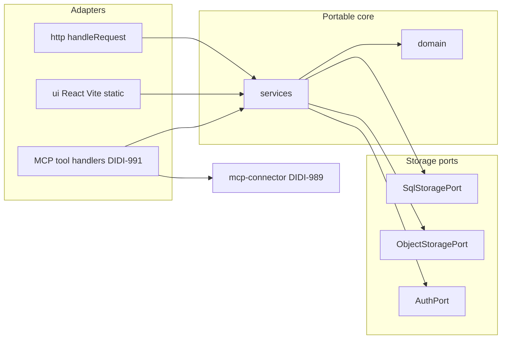

# Architecture overview: Physio POC

Proof of concept for practitioner exercise library, routines, programs, and an AI assistant connector. Approved design: [`design/README.md`](../../design/README.md). Accepted runtime decision: [`docs/decisions/0004-portable-runtime-and-storage-ports.md`](../decisions/0004-portable-runtime-and-storage-ports.md) (CTO, Oct 29, 2026).

## Purpose

- Web app for physiotherapists (Exercises, Routines, Programs, Requests) with mobile-first layout.
- One remote MCP server (Streamable HTTP, public HTTPS URL per DIDI-594) reusing the same business logic as the web app.
- **No patient information** in storage, logs, or tool schemas; programs use our id/code and a non-identifying `title` field (1 to 80 characters, patient-detail validator per ADR 0004).

## Boundaries

| In scope (this repo)                                                 | Out of scope (other tickets)                                   |
| -------------------------------------------------------------------- | -------------------------------------------------------------- |
| Domain types, services, storage ports, HTTP handler, UI shell layout | D1 binding, migrations, wrangler deploy (next ticket)          |
| In-memory adapters for tests                                         | Full screens, AuthPort implementation, and sign-in (DIDI-1001) |
| Health route and folder skeleton                                     | MCP route wiring and tool handlers (DIDI-991)                  |
| MCP JSON Schema module (`src/mcp-connector/`, DIDI-989)              | Kubernetes cutover planning (Diadem, migration ticket)         |

## Layered layout (`src/`)

```
src/
  domain/                 # Types; no I/O
  services/               # Use cases (shared by HTTP, UI, MCP)
  storage/
    ports/                # SqlStoragePort, ObjectStoragePort, AuthPort (future)
    adapters/memory/      # In-memory implementations for tests
  http/                   # handleRequest(Request) -> Response
  ui/                     # React + Vite static assets (390 px / 1280 px)
  entry/
    worker.ts             # Cloudflare Workers fetch entry
    node.ts               # Node HTTP entry (local / Kubernetes later)
  mcp-connector/          # DIDI-989 tool contract (PR #6); not in main until merged
```

**Dependency rule:** `domain` imports nothing from other layers. `services` imports `domain` and storage ports only. `http` and `ui` import `services`. `entry` imports `http`, `createAppDependencies`, and runtime APIs. **Domain and services must not import Cloudflare, Node-only modules, or other platform packages** (enforced by test).

**Composition:** One shared `createAppDependencies(config, adapters)` builds `AppDependencies`. Each entry reads its own env, passes in adapters, and nothing else reads env (ADR 0004).

## Interfaces

### Inbound

| Caller        | How                          | Entry                                                                               |
| ------------- | ---------------------------- | ----------------------------------------------------------------------------------- |
| Browser (UI)  | HTTPS (static assets + REST) | Same Worker `fetch` via `handleRequest`                                             |
| MCP clients   | Streamable HTTP at `/mcp`    | Same Worker, path-routed; public URL on workers.dev hostname (no custom domain yet) |
| Health checks | `GET /health`                | `src/http/routes/health.ts`                                                         |

### Outbound (via ports)

| Port                | Now (planned)                                        | Later                                                                                                         |
| ------------------- | ---------------------------------------------------- | ------------------------------------------------------------------------------------------------------------- |
| `SqlStoragePort`    | In-memory adapters in tests; target in-memory SQLite | SQLite on D1; Postgres adapter deferred to Kubernetes migration planning                                      |
| `ObjectStoragePort` | In-memory bytes in tests                             | R2 on Workers via adapter; port also maps to S3-compatible stores (put, get, head, delete, time-limited URLs) |
| `AuthPort`          | Not implemented in DIDI-996 skeleton                 | DIDI-1001: single practitioner, password hash in secret, HttpOnly signed session cookie                       |

Repository access in services uses a **portable SQL subset** with SQLite (D1) migrations; see ADR 0004.

## Runtimes

| Runtime            | Entry file            | Notes                                                                                |
| ------------------ | --------------------- | ------------------------------------------------------------------------------------ |
| Cloudflare Workers | `src/entry/worker.ts` | One Worker hosts UI static assets, REST, and `/mcp`; bindings added in later tickets |
| Node (local / K8s) | `src/entry/node.ts`   | `node:http` bridge to `handleRequest`                                                |

Both runtimes use the same `handleRequest` implementation and the same `createAppDependencies` pattern.

## Web app and MCP sharing



- **Services** implement program search, builder actions, publish semantics, and so on as tickets land.
- **MCP handlers** validate IO with `src/mcp-connector/` schemas, call services, and shape responses (`manage_url`, `search_link`, share link rules from DIDI-993).
- **PDF** is browser print from the link page (DIDI-1015). **Media generation** runs only in the gated main-branch workflow (DIDI-999), never in the app request path.
- **`practitioner_id`:** server-generated UUID from bootstrap or migration seed; never derived from email or name.

## UI

- **Stack:** React with Vite, built to static assets served by the same entry (no SSR framework).
- Mobile first at **390 px**; desktop mockups at **1280 px** (`design/README.md`).
- Shared nav: Exercises, Routines, Programs, Requests (copy from design specs only when implementing UI).

## Data flow (health check, v1 skeleton)

1. `GET /health` hits `handleRequest`.
2. Health route returns JSON status without reading personal data.
3. Future routes: `AuthPort` session check, call a service, service runs SQL via port and media via object port, return JSON or HTML.

## Environments

| Environment | Purpose            | Notes                                                                  |
| ----------- | ------------------ | ---------------------------------------------------------------------- |
| local       | Developer machines | Node entry; `.env` names in `.env.example` only                        |
| staging     | Pre-production     | Not defined in ADR 0004                                                |
| production  | Cloudflare Workers | workers.dev hostname; `/mcp` for MCP; custom DNS needs Diadem approval |

## Privacy

No patient-identifying fields in domain types or storage keys. Program `title` is non-identifying (trimmed, 1 to 80 characters, patient-detail validator). MCP contract adds structural guards (maxLength, banned property names, `validateFreeTextForPatientDetails` on the server). Update [`docs/privacy/data-map.yml`](../privacy/data-map.yml) when real tables and logs are added (next ticket).

## Related docs

- Design features: `design/app/*/spec.md`, `design/connector/claude-connector/spec.md`
- MCP contract (in flight): `docs/architecture/mcp-connector-contract.md` on branch `cursor/didi-989-mcp-tool-contract-4aea`
- Decisions index: [`docs/decisions/README.md`](../decisions/README.md)

## Further decisions

All former open questions from DIDI-996 are resolved in ADR 0004 (CTO, Oct 29, 2026). Do not reopen them in implementation tickets without a new ADR.
