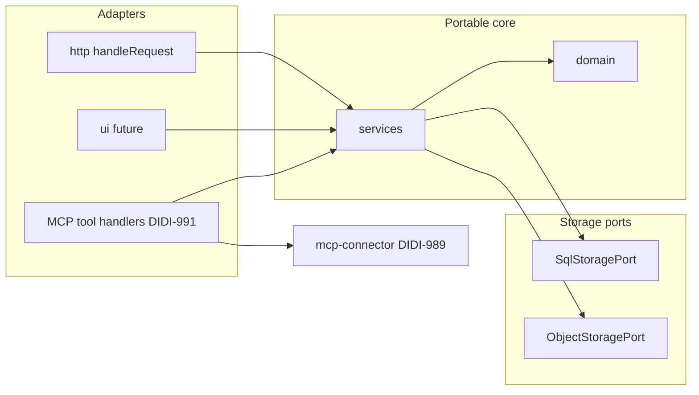

# Architecture overview — Physio POC

Proof of concept for practitioner exercise library, routines, programs, and an AI assistant connector. Approved design: [`design/README.md`](../../design/README.md). Accepted runtime decision: [`docs/decisions/0004-portable-runtime-and-storage-ports.md`](../decisions/0004-portable-runtime-and-storage-ports.md).

## Purpose

- Web app for physiotherapists (Exercises, Routines, Programs, Requests) with mobile-first layout.
- One remote MCP server (Streamable HTTP, public HTTPS URL per DIDI-594) reusing the same business logic as the web app.
- **No patient information** in storage, logs, or tool schemas; programs use our id/code and an optional non-identifying title only.

## Boundaries

| In scope (this repo)                                                 | Out of scope (other tickets)                                         |
| -------------------------------------------------------------------- | -------------------------------------------------------------------- |
| Domain types, services, storage ports, HTTP handler, UI shell layout | D1 binding, migrations, wrangler deploy (next ticket)                |
| In-memory adapters for tests                                         | Full screens and sign-in                                             |
| Health route and folder skeleton                                     | MCP server host and tool wiring (DIDI-989 contract, DIDI-991 server) |
| MCP JSON Schema module (`src/mcp-connector/`, DIDI-989)              | Production auth provider choice                                      |

## Layered layout (`src/`)

```
src/
  domain/                 # Types; no I/O
  services/               # Use cases (shared by HTTP, UI, MCP)
  storage/
    ports/                # SqlStoragePort, ObjectStoragePort
    adapters/memory/      # In-memory implementations for tests
  http/                   # handleRequest(Request) -> Response
  ui/                     # Web UI (390 px / 1280 px); not built in DIDI-996
  entry/
    worker.ts             # Cloudflare Workers fetch entry
    node.ts               # Node HTTP entry (local / Kubernetes later)
  mcp-connector/          # DIDI-989 tool contract (PR #6); not in main until merged
```

**Dependency rule:** `domain` imports nothing from other layers. `services` imports `domain` and storage ports only. `http` and future `ui` import `services`. `entry` imports `http` and runtime APIs. **Domain and services must not import Cloudflare, Node-only modules, or other platform packages** (enforced by test).

## Interfaces

### Inbound

| Caller              | How                               | Entry                                              |
| ------------------- | --------------------------------- | -------------------------------------------------- |
| Browser (future UI) | HTTPS                             | Same `handleRequest` behind Workers or Node        |
| MCP clients         | Streamable HTTP MCP on public URL | Separate MCP entry (DIDI-991) calling **services** |
| Health checks       | `GET /health`                     | `src/http/routes/health.ts`                        |

### Outbound (via ports)

| Port                | Now (planned)             | Later                                                    |
| ------------------- | ------------------------- | -------------------------------------------------------- |
| `SqlStoragePort`    | In-memory tables in tests | Cloudflare D1 (JSON TEXT params per CTO model)           |
| `ObjectStoragePort` | In-memory bytes in tests  | R2 on Workers; S3-compatible or equivalent on Kubernetes |

Repository access in services uses **SQLite-compatible SQL** through `SqlStoragePort` so the same statements can run on D1, local SQLite, or Postgres with adapter-specific DDL migrations (unknown: which SQL dialect features Postgres will need).

## Runtimes

| Runtime            | Entry file            | Notes                                                                                               |
| ------------------ | --------------------- | --------------------------------------------------------------------------------------------------- |
| Cloudflare Workers | `src/entry/worker.ts` | Thin `export default { fetch }`; bindings added in a later ticket (no wrangler changes in DIDI-996) |
| Node (local / K8s) | `src/entry/node.ts`   | `node:http` bridge to `handleRequest`                                                               |

Both runtimes use the same `handleRequest` implementation.

## Web app and MCP sharing



- **Services** implement program search, builder actions, publish semantics, and so on as tickets land.
- **MCP handlers** validate IO with `src/mcp-connector/` schemas, call services, and shape responses (`manage_url`, `search_link`, share link rules from DIDI-993).
- Until DIDI-989 merges, treat `src/mcp-connector/` as the planned import path; do not duplicate contract types in `services`.

## UI

- Mobile first at **390 px**; desktop mockups at **1280 px** (`design/README.md`).
- Shared nav: Exercises, Routines, Programs, Requests (copy from design specs only when implementing UI).
- `src/ui/` holds the future app shell; DIDI-996 does not add screens or user-facing copy beyond what specs quote.

## Data flow (health check, v1 skeleton)

1. `GET /health` hits `handleRequest`.
2. Health route returns JSON status without reading personal data.
3. Future routes: authenticate (unknown provider), call a service, service runs SQL via port and media via object port, return JSON or HTML.

## Environments

| Environment | Purpose                        | Notes                                                                                      |
| ----------- | ------------------------------ | ------------------------------------------------------------------------------------------ |
| local       | Developer machines             | `node src/entry/node.ts` (port TBD in runbook ticket); `.env` names in `.env.example` only |
| staging     | Pre-production                 | Unknown                                                                                    |
| production  | Live Workers then optional K8s | Unknown cutover criteria                                                                   |

## Privacy

No patient-identifying fields in domain types or storage keys. Program titles are optional and must remain non-identifying. MCP contract adds structural guards (maxLength, banned property names, `validateFreeTextForPatientDetails` on the server). Update [`docs/privacy/data-map.yml`](../privacy/data-map.yml) when real tables and logs are added (next ticket).

## Related docs

- Design features: `design/app/*/spec.md`, `design/connector/claude-connector/spec.md`
- MCP contract (in flight): `docs/architecture/mcp-connector-contract.md` on branch `cursor/didi-989-mcp-tool-contract-4aea`
- Decisions index: [`docs/decisions/README.md`](../decisions/README.md)

## Open questions

Unresolved items are listed in ADR 0004 and in the DIDI-996 PR under **Open questions for CTO**. Do not guess; record answers in new ADRs when decided.
