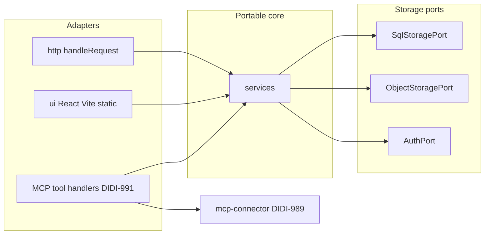

# Architecture overview: Physio POC

Proof of concept for practitioner exercise library, routines, programs, and an AI assistant connector. Approved design: [`design/README.md`](../../design/README.md). **Accepted** runtime and port decisions: [`docs/decisions/0004-portable-runtime-and-storage-ports.md`](../decisions/0004-portable-runtime-and-storage-ports.md) (CTO, Oct 29, 2026; includes QA round 1 rulings).

## Purpose

- Web app for physiotherapists (Exercises, Routines, Programs, Requests) with mobile-first layout.
- One remote MCP server (Streamable HTTP, public HTTPS URL per DIDI-594) reusing the same business logic as the web app.
- **No patient information** in storage, logs, or tool schemas. Programs use id/code; `title` is optional (DIDI-594) and when present is trimmed, 1 to 80 characters, with the DIDI-989 patient-detail validator (ADR 0004).

## Boundaries

| In scope (this repo)                                                   | Out of scope (other tickets)                                     |
| ---------------------------------------------------------------------- | ---------------------------------------------------------------- |
| Services, storage ports, in-memory fakes, HTTP handler, UI placeholder | Domain types (DIDI-997, DIDI-1000), D1 binding, migrations       |
| Platform entries and adapter folders (stubs)                           | AuthPort implementation (DIDI-1001), screens, signed object URLs |
| Health route and import guard                                          | MCP route wiring (DIDI-991), Kubernetes cutover (Diadem)         |
| MCP JSON Schema module (DIDI-989, physio-poc#6)                        | `better-sqlite3` test dependency (DIDI-997)                      |

## Layered layout (`src/`)

```
src/
  domain/                 # Placeholder until DIDI-997 / DIDI-1000
  services/               # Use cases (shared by HTTP, UI, MCP)
  storage/
    ports/                # SqlStoragePort, ObjectStoragePort
    adapters/memory/      # Plain TypeScript fakes for tests (not SQLite)
  adapters/
    node/                 # Platform adapters (Node); wiring in later tickets
    workers/              # Platform adapters (Workers)
  http/                   # handleRequest(Request) -> Response
  ui/                     # React + Vite static assets (390 px / 1280 px)
  entry/
    worker.ts             # Cloudflare Workers fetch entry
    node.ts               # Node HTTP entry (local / Kubernetes later)
  mcp-connector/          # DIDI-989 tool contract (physio-poc#6)
```

**Platform imports:** Only `src/entry/**` and `src/adapters/{node,workers}/**` may import Node, Workers, or other runtime-specific packages. Everything else under `src/` (including `src/ui/`) is checked by the import guard.

**Composition (planned):** One shared `createAppDependencies(config, adapters)` builds `AppDependencies`. Each entry reads its own env, passes in adapters, and nothing else reads env (ADR 0004).

## Interfaces

### Inbound

| Caller        | How                          | Entry                                                                               |
| ------------- | ---------------------------- | ----------------------------------------------------------------------------------- |
| Browser (UI)  | HTTPS (static assets + REST) | Same Worker `fetch` via `handleRequest`                                             |
| MCP clients   | Streamable HTTP at `/mcp`    | Same Worker, path-routed; public URL on workers.dev hostname (no custom domain yet) |
| Health checks | `GET /health`                | `src/http/routes/health.ts` (does not touch storage ports)                          |

### Outbound (via ports)

| Port                | DIDI-996                       | Later                                                                                   |
| ------------------- | ------------------------------ | --------------------------------------------------------------------------------------- |
| `SqlStoragePort`    | In-memory TypeScript fake      | D1 (SQLite migrations); Postgres adapter deferred to Kubernetes migration planning      |
| `ObjectStoragePort` | In-memory fake; `head` on port | R2 or S3-compatible adapters; time-limited signed URLs with bindings ticket             |
| `AuthPort`          | Not implemented                | DIDI-1001: single practitioner, password hash in secret, HttpOnly signed session cookie |

## Runtimes

| Runtime            | Entry file            | Notes                                                                                |
| ------------------ | --------------------- | ------------------------------------------------------------------------------------ |
| Cloudflare Workers | `src/entry/worker.ts` | One Worker hosts UI static assets, REST, and `/mcp`; bindings added in later tickets |
| Node (local / K8s) | `src/entry/node.ts`   | `node:http` bridge to `handleRequest`; local dev via `npm run dev`                   |

Both runtimes use the same `handleRequest` implementation.

## Web app and MCP sharing



- **Services** implement use cases as tickets land; domain types arrive in DIDI-997 / DIDI-1000.
- **MCP handlers** validate IO with `src/mcp-connector/` schemas, call services, and shape responses.
- **PDF** is browser print from the link page (DIDI-1015). **Media generation** runs only in the gated main-branch workflow (DIDI-999), never in the app request path.
- **`practitioner_id`:** server-generated UUID v4 from bootstrap; never derived from email or name. Signed-in API routes use `practitioners.id` from the auth session (DIDI-1001 maps Google sign-in email to that row), not the Better Auth `user.id`.

## UI

- **Stack:** React with Vite, built to static assets served by the same entry (no SSR framework).
- Mobile first at **390 px**; desktop mockups at **1280 px** (`design/README.md`).

## Data flow (health check, v1 skeleton)

1. `GET /health` hits `handleRequest` without reading storage ports.
2. Health route returns JSON status.
3. Future routes: `AuthPort` session check, call a service, service runs SQL and object ports, return JSON or HTML.

## Environments

| Environment | Purpose            | Notes                                                                  |
| ----------- | ------------------ | ---------------------------------------------------------------------- |
| local       | Developer machines | `npm run dev` (Node entry); `.env` names in `.env.example` only        |
| staging     | Pre-production     | Not defined in ADR 0004                                                |
| production  | Cloudflare Workers | workers.dev hostname; `/mcp` for MCP; custom DNS needs Diadem approval |

## Privacy

No patient-identifying fields in storage keys or logs. Optional program `title` follows ADR 0004 when present. Update [`docs/privacy/data-map.yml`](../privacy/data-map.yml) when real tables and logs are added.

## Related docs

- Design features: `design/app/*/spec.md`, `design/connector/claude-connector/spec.md`
- MCP contract: [physio-poc#6](https://github.com/didi-build/physio-poc/pull/6) (`docs/architecture/mcp-connector-contract.md` when merged)
- Decisions: [`docs/decisions/0004-portable-runtime-and-storage-ports.md`](../decisions/0004-portable-runtime-and-storage-ports.md) holds all DIDI-996 architecture answers; do not duplicate open questions elsewhere.
